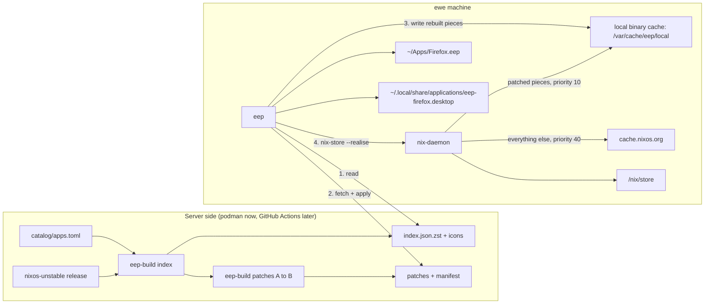

# eep — prototype guide

> **eep = ewe executable package.** Prototype plan, written 2026-11-22.
> Status: **0.2.0-beta** (2026-11-22): every app a card. Steps 0–6 done, in containers and the ewe VM;
> every go/no-go row passes (`bench/RESULTS.md`). Waiting on the owner:
> go/no-go (then RFC-010), B11 (real GPU), the GitHub repo. See **§13**.
> Read this once from top to bottom. Then work through the steps in order;
> every step ends with a **Done when** check. Don't start a step before the
> previous one is done.

## In one paragraph

eep installs apps the iOS way: every app is one small **card** file in
`~/Apps`. If the card is there, the app is in the launcher. Delete the card
and the app is gone. Underneath, the apps come prebuilt and signed from the
Nix binary cache (`cache.nixos.org`, 120k+ packages), but **your machine never
runs Nix's slow evaluation**: our own server makes an index that says exactly
what to download. Updates download **binary patches** made by our server
instead of whole packages. The prototype has to prove three things: **fast
installs, small updates, and apps that work properly on ewe.**

---

## 1. What we already know (measured 2026-11-21/22)

Measured with Nix in a podman container against NixOS 26.05 releases from
**Nov 10** (`ac588ef1c914`) and **Nov 19** (`3457b69ac4ab`).

| Question | Answer |
|---|---|
| First install (compressed download) | Firefox **446 MB** (pacman: 87), GIMP 367 (24), LibreOffice 858 (149), VLC 483 (6), Telegram 552 (56). All five together **1,567 MB**: 156 pieces are shared, 5.2 GB on disk |
| Plain Nix update of those five, Nov 10 → 19 | **1,312 MB**: all 610 pieces were new |
| …of which rebuild-only (same name and version, new hash) | **753 MB** |
| …of which real new versions | 559 MB (LibreOffice 25.8 → 26.2, Firefox 159 → 160, Qt 6.11.3, …) |
| Patch, glibc 2.42 (`zstd -19 --long=31 --patch-from`) | 10 MB → **12.8 KB** (only 6,534 of 35 MB bytes differ) |
| Patch, GIMP 3.0.8 | 22 MB → **1.1 MB** |
| Do patched pieces come out byte-identical? | **Yes, both** |
| What the narinfo signature covers | StorePath, NarHash, NarSize, References. **Not** URL, Compression, FileHash or FileSize. So the bytes can come from anywhere and Nix still verifies them |
| Cache compression | `Compression: zstd` (no longer only xz) |
| File list per piece | `https://cache.nixos.org/<hash>.ls`: JSON listing every file, so we can find `.desktop` files and icons without downloading |
| Unfree apps (Chrome, Discord, Spotify, Steam, NVIDIA) | **Not in the cache.** Out of scope |
| Stable vs Arch freshness | Stable lags: GIMP 3.0.8 vs Arch 3.2.8, LibreOffice 26.2 vs 26.8, Telegram 7.2.9 vs 7.4.4. **The prototype uses nixos-unstable** |
| Arch package | `extra/nix` 2.36.0 (4.9 MB) |
| This home link | cache downloads ran at a few hundred KB/s during the tests, and GitHub tarballs failed (HTTP/2 framing error). **Byte counts are reliable here; take timings from CI** |

Still unknown, and this is what the prototype is for: patch sizes when the
version really changes; how apps behave on ewe (GL, fonts, theme, sound,
portals); launch time; RAM; what running the patch server costs.

---

## 2. What the prototype must prove

| # | Goal |
|---|---|
| G1 | **Install with no evaluation on the client**: index in, pieces downloaded, app runs |
| G2 | **The Apps place**: a card in `~/Apps` means the app is in the launcher; delete the card and the app is gone and its disk space freed |
| G3 | **Small updates**: patches instead of whole pieces, with Nix still checking every byte |
| G4 | **Apps work on ewe**: graphics, fonts, cursor, dark mode, sound, file chooser, Wayland |
| G5 | **Numbers**: install, update, launch, RAM and disk compared with pacman |

**Not in the prototype:** unfree apps and NVIDIA; Komble UI; wiring the bar
badge (only `eep updates --count` JSON); ewe.conf and sync; our own store
engine (the prototype uses Nix as the engine); sandboxing; the fat `.eep`
export file. **The dev box gets nothing installed** except podman containers,
until the owner says go for the real-GPU check (Step 6, B11).

## 3. Prototype decisions (the owner can change any of these)

| Decision | Prototype choice | Why |
|---|---|---|
| Channel | `nixos-unstable` | Stable lags Arch by months; patches make frequent rebuilds cheap |
| Card | Small TOML card (~1 KB) | A fat single-file export can come later |
| Engine | **Real Nix** (`extra/nix`) does the store, signature checks and GC. **eep** does the index, cards, patches and desktop integration | Saves weeks; Nix's checks are battle-tested |
| Language | Rust workspace (client and builder share the formats) | Same stack as Komble; becomes the product |
| Test machine | ewe VM (`ewe-os/scripts/vm.sh`: 6 GB RAM, persistent disk); builder in podman, optionally GitHub Actions | House rule: never test on the machine you care about |
| Patch tool | `zstd` CLI with `--patch-from` | Proven above; move to the zstd crate later |
| Unfree | Out | Not in the cache; licenses forbid redistribution |

---

## 4. How it works



**The trick that keeps it safe:** eep rebuilds each patched piece into a
local binary cache (`/var/cache/eep/local`) next to the **original, signed
narinfo from cache.nixos.org**, changing only URL and Compression, which the
signature doesn't cover. `nix.conf` lists that folder as a substituter with a
higher priority than cache.nixos.org. Nix takes patched pieces from there and
everything else from upstream, and **checks every piece's signature and hash
itself**. A bad patch can't sneak in: it fails the hash check, and eep falls
back to the full download.

**Install:** read the index → compute missing pieces (closure minus what's
valid locally) → apply patches where an older base piece exists (none on a
first install) → `nix-store --realise <out> --add-root …` → copy the icon →
write the desktop entry → write the card atomically.

**Update:** the index is newer and the card's `out` differs → same flow for
the new `out`. The card keeps `previous`, and the previous root stays for 7
days so `eep rollback` is instant. A running app keeps its old files.

**Delete:** the card leaves `~/Apps` (deleted or moved to Trash) → the
watcher removes the desktop entry and GC root → `eep gc` frees the disk. A
card restored from Trash before GC comes back with no download.

---

## 5. Formats (v0 — expect changes)

### `catalog/apps.toml` (hand-written input)

```toml
[firefox]
attr = "firefox"
name = "Firefox"
kind = "gui"                    # gui | cli | tool | system
desktop = "firefox.desktop"     # optional; otherwise the only .desktop file found
```

The test set:

| id | attr | Why it's in the set |
|---|---|---|
| firefox | `firefox` | GTK3, GL, the daily app |
| libreoffice | `libreoffice` | Biggest closure (Java, Python) |
| gimp | `gimp` | GTK3 + plugins |
| vlc | `vlc` | Qt, sound, video decode |
| telegram | `telegram-desktop` | Qt6 |
| vscodium | `vscodium` | Electron on Wayland |
| calculator | `gnome-calculator` | GTK4 + libadwaita, dark mode via portal |
| ripgrep | `ripgrep` | Command-line app (PATH shim) |
| *tool* | `mesa-demos`, `vulkan-tools` | `eglinfo`, `glxinfo`, `vulkaninfo`, `vkcube` for driver checks |
| *system* | `mesa` | Driver bundle for `/run/opengl-driver` |

### `index.json` (builder output, served as `index.json.zst`)

```json
{
  "eep_index": 0,
  "channel": "nixos-unstable",
  "release": "nixos-26.11pre1125864.2786a2a72088",
  "rev": "2786a2a72088…",
  "made": "2026-11-23T09:00:00Z",
  "apps": {
    "firefox": {
      "name": "Firefox", "kind": "gui", "version": "160.0.1",
      "out": "/nix/store/<hash>-firefox-160.0.1",
      "exec": "bin/firefox",
      "desktop": "share/applications/firefox.desktop",
      "icon": "icons/firefox.svg",
      "closure": ["<hash>-glibc-2.42-103", "…"],
      "download": 467000000, "disk": 1404000000
    }
  },
  "pieces": { "<hash>-glibc-2.42-103": { "dl": 10249834, "nar": 35073152 } },
  "system": { "driver": ["/nix/store/<hash>-mesa-…"] }
}
```

### `patches/<from>__<to>.json` (builder output)

```json
{
  "from": "nixos-26.11pre1124497.0bb8272318b4",
  "to":   "nixos-26.11pre1125864.2786a2a72088",
  "patches": {
    "<newhash>-glibc-2.42-103": {
      "base": "<oldhash>-glibc-2.42-103",
      "file": "p/<newhash>.zst",
      "size": 12857,
      "full": 10249834,
      "nar_hash": "sha256:0d4zl9l50iprs7yv9q80ggsc5saazxdz9sq6vrrp0j8zdc8sxsw1",
      "narinfo": "StorePath: …\nNarHash: …\nReferences: …\nSig: cache.nixos.org-1:…\n"
    }
  }
}
```

How the base is chosen: the same name in the old release; failing that, the
same pname with a different version (strip from the first `-<digit>`);
failing that, no patch. **Skip a patch bigger than 60% of the full download.**

### The card: `~/Apps/Firefox.eep` (TOML)

```toml
eep = 0
id = "firefox"
name = "Firefox"
channel = "nixos-unstable"
release = "nixos-26.11pre1125864.2786a2a72088"
version = "160.0.1"
out = "/nix/store/<hash>-firefox-160.0.1"
exec = "bin/firefox"
previous = "/nix/store/<hash>-firefox-159.0.1"   # kept 7 days for rollback
installed = 2026-11-23T10:00:00Z
```

**The card is the truth the user sees.** Everything else eep keeps (roots,
icons, desktop entries) can be rebuilt from the cards with `eep repair`. The
file name doesn't matter; the `id` inside does.

### eep's own places

| Path | What |
|---|---|
| `~/Apps/*.eep` | Cards (the user's) |
| `~/.cache/eep/` | Index, updates.json |
| `~/.local/state/eep/roots/<id>`, `<id>.prev` | GC roots |
| `~/.local/share/eep/icons/`, `bin/`, `data/<id>/` | Icons, CLI shims, per-app data (stretch goal) |
| `~/.local/share/applications/eep-<id>.desktop` | Launcher entries |
| `/var/cache/eep/local/` | Local binary cache for patched pieces (group `nix-users`) |
| `/var/lib/eep/opengl-driver/` | Driver symlink farm; `/run/opengl-driver` points here |

---

## 6. Repo layout (new repo `eep/`)

```
eep/
├── PROTOTYPE.md            this guide
├── README.md
├── Cargo.toml              workspace
├── crates/
│   ├── eep-core/           formats (index, manifest, card), store-path parsing, nix base32
│   ├── eep/                client CLI
│   └── eep-build/          server side: index + patches (drives nix in podman), eval.nix
├── catalog/apps.toml
├── dist/                   builder output, git-ignored: <release>/index.json.zst, icons/, patches/
├── vm/setup-guest.sh       guest setup (Step 0)
├── bench/                  benchmark scripts + RESULTS.md
└── .github/workflows/      Step 1b, only after the owner OKs a GitHub repo
```

## 7. House rules that apply (from `project-map/09-Rules`)

- **Rule 5:** every `eep` command prints JSON and exits 0. Errors are `{"ok":false,"error":"…"}`.
- **Rule 1:** the prototype doesn't touch `ewe.conf` at all. Recording installs through `ewe-conf` comes after the go.
- **Rule 9:** eep writes only its own files (table above), never ewe's deployed config.
- **Rule 10:** pacman stays the only package manager on real machines. During the prototype eep runs only in the VM. Changing the rule needs RFC-010 after the go/no-go.
- **Git:** commit and push only when the owner asks. The GitHub repo is created only with the owner's OK.

**Owner decision points:** (a) create `prj786/eep` on GitHub, needed for the
CI builder; (b) the one-hour real-GPU test on the dev box (B11); (c) go/no-go
in Step 7.

---

## 8. The steps (about 10 working days)

### Step 0 — Set up (½–1 day)

Goal: an empty repo, a builder that can run Nix, and a VM with ewe and Nix.

- [x] Repo: `mkdir -p ~/Projects/ewe/eep && cd ~/Projects/ewe/eep && git init -b main` (this guide is the first commit, when the owner says so).
- [x] Rust workspace with the three crates; `cargo build` is green. Dependencies: `serde`, `serde_json`, `toml`, `tokio`, `reqwest` (rustls), `sha2`, `notify`, `anyhow`.
- [x] Builder container with a persistent Nix cache, so tarballs download only once:
  ```sh
  podman volume create eep-nix
  podman run --rm -v eep-nix:/root/.cache/nix docker.io/nixos/nix nix --version
  ```
- [x] VM: get an ewe ISO (`ewe-os/build.sh`, or the 0.17.0-beta ISO from the ewe-os GitHub release). Then:
  ```sh
  export EWE_VM_DIR=~/vm/eep          # a real disk, NOT tmpfs /tmp (40G target disk)
  ~/Projects/ewe/ewe-os/scripts/vm.sh up --gui
  ```
  Install ewe on the target disk. Follow `ewe-os/docs/TESTING.md` "Install path" and add the guest agent before rebooting. Then `vm.sh reboot-disk`.
- [x] Guest setup (`vm/setup-guest.sh`):
  ```sh
  sudo pacman -S --needed nix zstd hyperfine
  sudo systemctl enable --now nix-daemon.socket
  sudo usermod -aG nix-users "$USER"            # log out and back in
  sudo install -d -m 2775 -g nix-users /var/cache/eep/local /var/cache/eep/local/nar
  printf 'StoreDir: /nix/store\nWantMassQuery: 0\nPriority: 10\n' \
    | sudo tee /var/cache/eep/local/nix-cache-info
  sudo tee -a /etc/nix/nix.conf <<'EOF'
  experimental-features = nix-command
  extra-substituters = file:///var/cache/eep/local?priority=10
  narinfo-cache-negative-ttl = 0
  EOF
  sudo systemctl restart nix-daemon
  ```
- [ ] Measure the link once, on the host and in the VM (10 MB glibc piece):
  ```sh
  curl -o /dev/null -w '%{speed_download} B/s\n' \
    https://cache.nixos.org/nar/0d4zl9l50iprs7yv9q80ggsc5saazxdz9sq6vrrp0j8zdc8sxsw1.nar.zst
  ```
- [x] Take a VM snapshot so every benchmark starts clean: with the VM down, run `qemu-img snapshot -c clean "$EWE_VM_DIR/target.qcow2"`.

**Done when:** `cargo build` is green; the container prints a Nix version; in
the VM, `nix-store --realise /nix/store/pagq7gjgxqbi09g0091x2cxwq2kwxyx8-glibc-2.42-103`
downloads that piece from cache.nixos.org (this proves the daemon, the
substituter and signature checking work).

### Step 1 — The index builder (1 day)

Goal: `eep-build index --release <name>` writes `dist/<release>/index.json.zst`
and the icons.

- [x] `eep-build releases` lists the newest nixos-unstable releases with dates (see Reference). Pick **B** = the newest, **A** = about 7 days older, and **A1** = the one just before B (the daily pair).
- [x] Evaluate **all catalog attrs in one Nix call**, from the release's `nixexprs.tar.xz` on releases.nixos.org (not GitHub, which failed for us):
  ```nix
  # crates/eep-build/eval.nix
  { url, attrs }:
  let
    p = import (fetchTarball url) { config.allowUnfree = false; };
    lib = p.lib;
    one = n: let d = lib.getAttrFromPath (lib.splitString "." n) p; in {
      out = d.outPath;
      version = d.version or "";
      mainProgram = d.meta.mainProgram or "";
      free = lib.all (l: l.free or true) (lib.toList (d.meta.license or []));
    };
  in lib.genAttrs attrs one
  ```
  ```sh
  podman run --rm -v eep-nix:/root/.cache/nix -v "$PWD/crates/eep-build:/work:ro" \
    docker.io/nixos/nix nix eval --json --impure --extra-experimental-features nix-command \
    --expr 'import /work/eval.nix { url = "https://releases.nixos.org/nixos/unstable/<release>/nixexprs.tar.xz"; attrs = [ "firefox" "gimp" ]; }'
  ```
- [x] Get closures and sizes in one call: `nix path-info --store https://cache.nixos.org --json -r <outs…>`. Pin `--json-format` (Nix warns that a bare `--json` is deprecated; what we got was a dict keyed by path with `downloadSize`, `narSize`, `narHash` and `references`). If a piece is missing from the cache, the app is marked `unavailable`.
- [x] Find the desktop file and icon from `https://cache.nixos.org/<hash>.ls` (JSON listing). Pick the icon in this order: `share/icons/hicolor/scalable/apps/*.svg`, then the largest PNG, then `share/pixmaps`. Read the files with `nix store cat --store https://cache.nixos.org <path>` (downloads only that piece) and follow symlinks into other pieces. Copy the icon to `dist/<release>/icons/<id>.<ext>`.
- [x] Driver: read `nixos/modules/hardware/graphics.nix` in that release to see exactly what NixOS puts into `/run/opengl-driver`, and record the same paths under `system.driver`.
- [x] Write `index.json`, compress it with `zstd -19`, and print a summary JSON (apps, pieces, total download).

**Done when:** indexes exist for A, A1 and B; the firefox entry has `out`,
`closure`, sizes, `desktop` and `icon`; running twice on the same release gives
byte-identical output.

**Step 1b (optional, needs the owner's OK for a GitHub repo):** run the same
builder in GitHub Actions, on demand and on a schedule, and publish `dist/` as
release assets. Needed if the home link is too slow for building patches in
Step 4 (which downloads both releases' full pieces, 2–5 GB).

### Step 2 — Install and run, no patches yet (2 days)

Goal: in the VM, `eep install firefox` puts Firefox in the launcher, and it
opens and works.

- [x] Serve `dist/` from the host with `python3 -m http.server -d dist 8000`. The VM reaches the host at `http://10.0.2.2:8000` (QEMU user networking).
- [x] `eep index update`: download the index into `~/.cache/eep/`, using ETag / If-Modified-Since.
- [x] `eep install <id>`: plan → `nix-store --realise <out> --add-root ~/.local/state/eep/roots/<id>` → icon → desktop entry → card. Output looks like `{"ok":true,"id":"firefox","download":…,"pieces_new":…,"seconds":…}`.
- [x] Desktop entry: copy the app's `.desktop` to `~/.local/share/applications/` **under its own file name** (changed 2026-11-22: `eep-<id>.desktop` broke the window → app match, see Gotcha 26). Rewrite **every** `Exec=` (including `[Desktop Action …]`) to `eep run <id> -- <original args>`, set `Icon=` to the absolute path of our icon copy, drop `TryExec`, and add `X-Eep-Id=<id>`. Check that ewe's launcher picks it up without a restart; if it doesn't, note what refreshes it.
- [x] CLI apps: symlink `~/.local/share/eep/bin/<mainProgram>` to the binary in the store. For the prototype, add that directory to PATH in the VM's `~/.zshrc`; later ewe's session adds it.
- [x] `eep run <id> [args]`: read the card, fix the environment, then `execve` (no leftover parent process). Start with these rules and change them only with evidence:

  | Variable | Rule | Why |
  |---|---|---|
  | `LD_LIBRARY_PATH`, `LD_PRELOAD` | unset | Arch libraries inside a Nix app = crash |
  | `GTK_PATH`, `GIO_EXTRA_MODULES` | unset | Arch GTK/GIO modules, wrong ABI |
  | `QT_PLUGIN_PATH`, `QML2_IMPORT_PATH`, `QML_IMPORT_PATH` | unset | Arch Qt plugins, wrong ABI |
  | `GST_PLUGIN_PATH*`, `GST_PLUGIN_SYSTEM_PATH*` | unset | Arch GStreamer plugins, wrong ABI |
  | `PYTHONPATH`, `PERL5LIB` | unset | Host modules |
  | `VK_ICD_FILENAMES`, `VK_DRIVER_FILES`, `__EGL_VENDOR_LIBRARY_*`, `LIBGL_DRIVERS_PATH`, `LIBVA_DRIVERS_PATH` | unset | Nix finds drivers in `/run/opengl-driver` |
  | `XDG_DATA_DIRS` | keep the host's | Themes, icons, cursors from `/usr/share` |
  | `XCURSOR_PATH` | `~/.local/share/icons:~/.icons:/usr/share/icons:/usr/share/pixmaps` | Nix libXcursor doesn't look in `/usr/share/icons` by itself |
  | `FONTCONFIG_FILE` | `/etc/fonts/fonts.conf` (test) | Use ewe's fonts and config |
  | `LOCALE_ARCHIVE` | test Arch's `/usr/lib/locale/locale-archive` against nixpkgs `glibcLocalesUtf8` | No "cannot set locale" warnings |
  | `NIXOS_OZONE_WL` | `1` | nixpkgs Electron wrappers then use native Wayland |
  | `QT_QPA_PLATFORMTHEME` | decide in this step (ewe sets `qt6ct`, which Nix Qt lacks) | See Gotcha 7 |

- [x] Driver, the one root step: `sudo eep driver install` realises the driver paths with root `/nix/var/nix/gcroots/eep-driver`, builds the symlink farm `/var/lib/eep/opengl-driver` the way NixOS does, and writes a tmpfiles rule `L+ /run/opengl-driver - - - - /var/lib/eep/opengl-driver`, then runs `systemd-tmpfiles --create`.
- [x] `eep doctor`: JSON report covering whether the daemon is reachable, the substituters, the driver link, PATH, and the final environment for an app.

**Done when** all 8 apps pass this checklist in the VM (screenshots via
`vm.sh shot`):
- [x] Opens from the launcher and from `eep run`
- [x] Graphics: `eglinfo -B` and `vulkaninfo --summary` show the virgl/llvmpipe driver, not an error. Firefox `about:support` shows WebRender
- [x] Fonts match pacman apps, and the cursor theme and size are right
- [x] Dark mode is right (the calculator follows it via the portal)
- [x] Sound plays in VLC; the file chooser (portal) opens in GIMP
- [x] VSCodium runs native Wayland (`hyprctl clients` shows `xwayland: 0`)
- [x] No locale warnings on stderr

If something breaks, check the Gotchas, and write every fix into the
environment table with its reason.

### Step 3 — The Apps place (1 day)

- [x] `~/Apps` holds one card per app. Writes are atomic (`.Name.eep.tmp`, then rename).
- [x] `eep watch` runs as a systemd user service, watching `~/Apps` with inotify (500 ms debounce):
  - card appears (copied in) and isn't installed → install it
  - card deleted or moved to Trash → remove the desktop entry and GC root (pieces stay until gc)
  - card renamed → nothing (the `id` inside counts)
- [x] `eep gc` and `eep gc --dry-run` (`nix-store --gc`) report bytes freed and seconds.
- [x] `eep open <file.eep>` plus MIME type `application/x-eep` (`~/.local/share/mime/packages/eep.xml`), set as the default handler, so double-clicking a card installs it if needed and then runs it.
- [ ] Stretch: show the card's icon in Files via a freedesktop thumbnailer (`~/.local/share/thumbnailers/eep.thumbnailer` → `eep thumbnail %i %o %s`). Check whether ewe Files supports thumbnailers.
- [ ] Stretch: per-app data. `eep run` points `XDG_CONFIG_HOME`, `XDG_DATA_HOME`, `XDG_CACHE_HOME` and `XDG_STATE_HOME` to `~/.local/share/eep/data/<id>/…`. Record which of the 8 apps respect it (Firefox may still use `~/.mozilla`). "Delete with data" removes that folder.

**Done when:** deleting the Firefox card removes it from the launcher within
2 s; `eep gc` frees about the app's unique bytes (compare with the index);
restoring the card from Trash before gc brings it back with no download.

### Step 4 — Patches (2 days)

Goal: updating from A to B downloads patches for most pieces, and Nix still
verifies everything.

Builder (`eep-build patches --from A --to B`):
- [x] For every piece in B's closures that isn't in A's, choose a base (same name, then same pname, then none).
- [x] Download both NARs and decompress them (zstd or xz).
- [x] Make the patch: `zstd -19 --long=31 --patch-from=<base.nar> <new.nar> -o p/<newhash>.zst`.
- [x] Apply it back and `cmp` the result (it must be identical). Skip the patch if it's bigger than 60% of the full download.
- [x] Write the manifest, including the upstream narinfo text. Delete NARs as you go (they take GBs).
- [x] Record the cost: wall time, CPU, peak RAM, and patch bytes vs full bytes.

Client:
- [x] For each missing piece that has a patch and whose base is valid locally:
  1. Fetch the patch.
  2. `nix-store --dump /nix/store/<base> > /var/tmp/eep/<base>.nar`
  3. `zstd -d --long=31 --patch-from=/var/tmp/eep/<base>.nar patch.zst -o /var/cache/eep/local/nar/<newhash>.nar`
  4. Fast-fail check that the sha256 matches `NarHash` (Nix checks again anyway).
  5. Write `/var/cache/eep/local/<newhash>.narinfo` as the upstream narinfo with `URL: nar/<newhash>.nar` and `Compression: none`, with FileHash and FileSize removed. **Leave `Sig` untouched.**
- [x] Then run the normal realise: Nix takes patched pieces from the local cache (priority 10) and the rest from cache.nixos.org (priority 40).
- [x] Clear the local cache and temp NARs after success.
- [x] Apply at most 4 patches at a time, with a RAM cap: patching a 1 GB piece needs about 1–2 GB.
- [x] Add a `--no-patches` flag for comparison runs.
- [x] Tamper test: flip one byte in a patch → eep's check fails → full download instead. Skip eep's check → Nix must reject the piece → eep reports it and falls back.

**Done when:** the A → B update of all 8 apps runs with patches, every app
starts afterwards, and `nix store verify -r <out>` passes for each.

### Step 5 — Updates UX (1 day)

- [x] `eep updates` returns JSON per app: id, old and new version, `rebuild_only`, download with patches, download without.
- [x] `eep updates --count` returns `{"ok":true,"count":3}`, the shape the bar's `updates-check.sh` will read later. **Don't wire it into ewe during the prototype.**
- [x] `eep update [ids…]` updates one app, several, or all. The card gets `previous`. Test: keep Firefox open during its update; it keeps working, and the next launch is the new version.
- [x] `eep rollback <id>` swaps `out` and `previous` instantly, with no download.
- [x] A systemd user timer runs `eep index update && eep updates` every 6 h and 2 min after login, caching the result in `~/.cache/eep/updates.json`.
- [x] Rebuild-only updates (same version) are flagged so they can later be applied quietly.

**Done when:** the A → B scenario gives sensible JSON, and an update plus
rollback round trip leaves every app working.

### Step 6 — Measure (1–2 days)

Restore the `clean` VM snapshot before each install or update benchmark.
Count bytes with the VM network counter
(`/sys/class/net/<if>/statistics/rx_bytes`) and eep's own count.

| # | What | How | Compare with |
|---|---|---|---|
| B1 | First install: bytes and time, per app and all 8 | `eep install` on a fresh store | `pacman -S` in the same VM (clean pkg cache) |
| B2 | Weekly update A → B: bytes and time | `eep update` vs `eep update --no-patches` | Plain Nix |
| B3 | Daily update A1 → B | Same | Plain Nix |
| B4 | Launch time, cold + warm, median of 5 | From exec until Hyprland's socket2 `openwindow` event | pacman build of the same app |
| B5 | `eep run` overhead | `hyperfine 'eep run ripgrep -- --version' '<store>/bin/rg --version'` | — |
| B6 | Idle RAM (Firefox, 1 tab, after 60 s) | RSS / PSS | pacman Firefox |
| B7 | Disk | `/nix/store` size after 8 apps; after A → B, before and after gc | pacman sizes |
| B8 | Delete | Card delete → gone from launcher (s); bytes freed by gc | — |
| B9 | Patch server cost | Builder time, CPU, RAM, storage per release | — |
| B10 | Mixed releases | App from A + driver from B: does GL still work? | — |
| B11 | Real GPU (**owner go only**) | Dev box for one hour: `pacman -S nix`, Firefox + `vkcube` + VLC VA-API on the real GPU, then `pacman -Rns nix && sudo rm -rf /nix /var/cache/eep /var/lib/eep` | — |

Write everything into `bench/RESULTS.md`: the date, release names, link speed
and VM spec.

### Step 7 — Write up and decide (½ day)

- [x] `bench/RESULTS.md` is complete, and the go/no-go table below has an answer per row.
- [ ] **Go:** draft **RFC-010 "eep — apps from the Nix cache"** in `project-map/08-Decisions/` and add it to the Decision Index. Propose rewording Rule 10 as "pacman for the system, eep for apps". Add `eep/` to `AGENTS.md`. Run `project-map/.vault/vault-check.sh` until it's green.
- [ ] **No-go:** record why in `08-Decisions/Parked and Rejected Ideas.md`.

## 9. Go / no-go

| # | Claim | Passes if |
|---|---|---|
| 1 | No evaluation on the client | Install never runs `nix eval`; `eep install` takes no more than download time + 15 s |
| 2 | Small updates | Rebuild-heavy pair: patched ≤ 10% of plain bytes. Version-bump pair: ≤ 50% |
| 3 | Safe | Every patched piece is byte-identical and passes `nix store verify`; a tampered patch never lands |
| 4 | Apps work | All 8 pass the Step 2 checklist |
| 5 | Fast to launch | Warm launch within +10% of pacman's; `eep run` overhead < 10 ms |
| 6 | iOS-style delete | Launcher updates in < 2 s; gc frees ≥ 95% of the app's unique bytes |
| 7 | Affordable server | One release for the catalog builds in < 30 min on a CI runner |

One known cost is not a fail by itself: **the first install downloads several
times more than pacman** (B1), because the first app brings its own base.
Record it honestly.

## 10. Gotchas we already know

1. **Everything re-hashes when something low changes.** Use name and version to decide "same app" in the UI; use hashes for files.
2. **GitHub tarballs failed here** (HTTP/2 framing error). Evaluate from `releases.nixos.org/.../nixexprs.tar.xz`.
3. **`nix path-info --json` without `--json-format` is deprecated.** Pin the format.
4. **Unfree pieces are missing from the cache.** Mark the app unavailable; never try to build it.
5. **Narinfo negative cache:** by default Nix remembers "not in this cache" for an hour, so the local cache would be ignored after one miss. Hence `narinfo-cache-negative-ttl = 0`.
6. **Host variables leak Arch libraries** into Nix apps (`LD_LIBRARY_PATH`, GStreamer/Qt/GTK paths) and crash them. `eep run` clears them.
7. **ewe exports `QT_QPA_PLATFORMTHEME=qt6ct` and `QT_STYLE_OVERRIDE=Fusion`** (`ewe/dotfiles/hypr/start-hyprland.sh:148-149`). Nix Qt has no qt6ct plugin, so expect a warning and a plain theme. Decide in Step 2.
8. **Applying a patch needs RAM about the size of the old piece.** LibreOffice's biggest piece is about 1 GB unpacked, so limit parallel patches.
9. **Temp NARs go in `/var/tmp`** (real disk), never `/tmp` (tmpfs). The same goes for the builder's work folder and `EWE_VM_DIR`.
10. **`/run` is cleared at every boot**, so `/run/opengl-driver` must come from a tmpfiles rule.
11. **Driver vs app release:** Mesa from a newer release might need a newer glibc than an older app has. That's what B10 tests. The policy may become "the driver updates together with the apps".
12. **Unstable's names change when NixOS 26.11 branches off** (end of November 2026): `nixos-26.11pre…` becomes `nixos-27.05pre…`. Don't hard-code the prefix.
13. **On this home link, bytes are the reliable number;** take time numbers from CI (Step 1b) or a better link.
14. **Arch's `nix` has no `nix-users` group** (only `nixbld`; the daemon socket is open to every user). `usermod -aG nix-users` fails. eep creates its own group `eep` for `/var/cache/eep/local` (`vm/setup-guest.sh`).
15. **IPv6 is black-holed on this home link.** Raw IPv6 connects to Fastly time out while curl hides it (it races both families). A client that tries addresses in order waits ~13 s per new host. eep races one TCP connect per family at startup and goes IPv4-only when IPv6 loses by 300 ms (`eep-core/src/http.rs`; `EEP_IP_FAMILY=4|6|any` overrides).
16. **Nix 2.36 prints the gc summary on stdout** (`N store paths deleted, X MiB freed`), not stderr, and no per-path lines. eep parses the summary from either stream.
17. **TLS and zstd crawl in unoptimized Rust.** The workspace builds dependencies at `opt-level = 2` even in dev, or every HTTPS handshake costs seconds.
18. **Conditional GETs: validators belong to one URL.** After switching servers, the old `Last-Modified` got a 304 from the new server (its pointer was a second older). eep keeps the URL next to the validators and drops them when it changes.
19. **Nix falls back by itself.** When a patched piece in the local cache fails its hash, Nix reports `hash mismatch importing path` and takes the piece from the next substituter (cache.nixos.org). eep's own check and its retry-without-patches are extra safety nets.
20. **This host lacks `qemu-img` and QEMU's virtio display** (Arch ships `qemu-img` and `qemu-hw-display-virtio-vga` apart from `qemu-system-x86`). `vm/qemu-img.sh` runs qemu-img in a container; `EWE_VM_VGA=VGA` (new in ewe-os `scripts/vm.sh`) boots with the standard VGA. The guest renders in software either way (vm.sh never enabled virgl).
21. **Write system files durably.** An unclean VM power-off (vm.sh `down` kills after 10 s) left `/etc/tmpfiles.d/eep-driver.conf` at 0 bytes, so `/run/opengl-driver` was gone after the reboot. `write_atomic` now syncs the file and its directory; the driver step also syncs `/var/lib/eep`.
22. **The guest agent is one channel.** A second `vm.sh ga` while a long one runs fails (`EAGAIN`) or steals its replies. Run one at a time.
23. **`nix store info` prints to stderr**; `--json` prints to stdout. **`extra-substituters` can't be read back**: it merges into `substituters`.
24. **A power cut right after an install can corrupt "valid" store paths.** Nix registers a path before its files are surely on disk (`fsync-store-paths` is off by default). In the VM, mesa's EGL vendor file was 0 bytes after an unclean power-off, so no Nix app had GL. eep now syncs the store after every fetch (one `syncfs`) and keeps a crash journal: after a crash the next eep command verifies what was registered since and deletes the damage, which the install then fetches again (`crates/eep/src/journal.rs`, `test/crash.sh`).
25. **ewe's shell leaks `__EGL_VENDOR_LIBRARY_FILENAMES` (Arch's Mesa) and `VK_DRIVER_FILES`** to every app it starts (`qs-launch.sh` pins them for the shell's RAM diet; the comment says "shell only"). With them, Nix's glvnd asks for a bare `libEGL_mesa.so.0` and finds nothing. `eep run` removes both (rule confirmed), and PATH shims now go through `eep run` too (busybox-style links to eep).
26. **Keep the app's own desktop file name.** Wayland app id = desktop file name: `eep-telegram.desktop` made ewe's bar say "Desktop" with no icon, and Telegram wrote a broken `userapp-Telegram Desktop-*.desktop` on every start. eep writes `org.telegram.desktop.desktop` etc., owns them by `X-Eep-Id`, and only prefixes when the user or another app has that name.
27. **`hyprctl dispatch exec …` doesn't exist with ewe's Lua config**: use `hyprctl dispatch 'hl.dsp.exec_cmd("…")'`. Hyprland's own environment lacks `HYPRLAND_INSTANCE_SIGNATURE`; take the session env from the shell (`qs`).
28. **Republished index, same release:** compare the pointer's sha256, not only the release name, and only send conditional headers when the held index's sha256 is known.
29. **`eep` must not trust `PATH` for itself in launchers.** Entries call eep by absolute path (`std::env::current_exe`); `eep repair` rewrites them when eep moves.
30. **Nix apps can't resolve this machine's own name on Arch.** Arch answers it through systemd's NSS modules (myhostname, resolve), which Nix's glibc can't load; the lookup falls through to DNS and waits for a timeout. Firefox started in 8.7 s instead of 0.76 s. `sudo eep driver install` adds one marked line to /etc/hosts (`127.0.1.1 <name> # eep: …`) and the driver timer keeps it in step with renames. mDNS `.local` names stay unresolvable for Nix apps (NixOS runs nsncd for this).
31. **A running watcher keeps the old eep after an update.** `eep watch` now watches its own binary and re-execs itself when the file is replaced (same PID, new code). Earlier, an old watcher removed launchers by the old naming and left the new ones behind.
32. **The old naming rule deleted `eep-open.desktop`** (the card handler) as the leftovers of an app called "open". Ownership is now only by `X-Eep-Id`; files without it are never eep's.

33. **Hide a found app with `NoDisplay=true`, never `Hidden=true`.** `Hidden` means "deleted" to GIO too: a hidden ewe Files would stop opening folders (inode/directory) and every MIME default naming it would break. eep's hiding copy keeps the whole entry plus `NoDisplay=true` and `X-Eep-Hides=<id>`, and eep only ever replaces or deletes an entry carrying its own mark.
34. **A desktop file in `~/.local/share/applications` replaces the system one entirely** (same desktop id). The hiding copy is therefore the full entry, not a stub; when pacman updates the system entry, eep refreshes its copy (newer mtime). A user-level entry (Steam's, Komble's, the user's own) is first copied byte for byte to `~/.local/share/eep/hidden/` and comes back from there.
35. **Icon themes are huge** (Reversal: 208,000 files). Find icons the spec's way: `index.theme` → `Directories` + `Inherits`, then a `stat` per folder; never walk a theme. Icons above 96 KB (Zed ships only a 168 KB 512 px PNG) go through `magick` to 256 px.
36. **Komble's AppImage entries can name a `TryExec` that no longer exists** (a `.komble-run/<id>` link to a missing folder): GIO hides such an entry, and so does eep (no card). The AppImage would not start anyway.
37. **A broken card or a moved `~/Applications` must change nothing.** Forgetting (eep apps) and hiding (found apps) run only after a *sure* listing: the folder was read and every card's id is known (a card that doesn't parse keeps its id through a lenient TOML read). The watcher never recreates a moved `~/Applications` (it waits on the parent for it to come back); it makes the folder only on the very first run.
38. **Index fields are network input, and root reads them** (the driver timer). `Index::validate` runs on every fetch and load (and in `eep-build` before publishing): plain names for release/channel/ids, store paths for out/closure/driver, `inside()` for exec/desktop/icon, plain program names for `bin`. Fable's review found `release = "/etc/cron.d"` and `eep remove '../..'` reaching outside eep's folders before this.

## 11. Reference

```sh
# newest unstable releases (change the prefix after 26.11 branches off)
curl -s "https://nix-releases.s3.amazonaws.com/?delimiter=/&prefix=nixos/unstable/nixos-26.11" \
  | grep -oE 'nixos-26\.11pre[0-9]+\.[0-9a-f]+' | sort -uV | tail
# the release the channel points at right now
curl -sI https://channels.nixos.org/nixos-unstable | grep -i location
# date and git revision of a release
curl -sI https://releases.nixos.org/nixos/unstable/<release>/nixexprs.tar.xz | grep -i last-modified
curl -s  https://releases.nixos.org/nixos/unstable/<release>/git-revision
# one piece: signed info and file listing
curl -s https://cache.nixos.org/<hash>.narinfo
curl -s --compressed https://cache.nixos.org/<hash>.ls
# a patch by hand (what produced the 12.8 KB glibc result)
zstd -19 --long=31 -f --patch-from=old.nar new.nar -o p.zst
zstd -d  --long=31 -f --patch-from=old.nar p.zst -o rebuilt.nar && cmp new.nar rebuilt.nar
```

Releases measured on 2026-11-22 (NixOS 26.05):
`nixos-26.05.13936.ac588ef1c914` (Nov 10) → `nixos-26.05.14753.3457b69ac4ab` (Nov 19).
Latest unstable on 2026-11-21: `nixos-26.11pre1125864.2786a2a72088`.

## 12. Sources

- Unfree software is not built by Hydra or cached: <https://wiki.nixos.org/wiki/Unfree_Software>
- Narinfo format: <https://nix.dev/manual/nix/2.35/protocols/binary-cache/narinfo>
- OpenGL for Nix apps outside NixOS: <https://wiki.nixos.org/wiki/Nixpkgs_with_OpenGL_on_non-NixOS>
- snix `nix-compat` (NAR and narinfo in Rust, for the later own engine): <https://snix.dev/rustdoc/nix_compat/index.html>
- composefs (an idea for later, shared content-addressed images): <https://github.com/containers/composefs>
- Haiku packagefs (the "drop the file in, it's installed" model): <https://www.haiku-os.org/docs/develop/packages/Infrastructure.html>

## 13. Progress log

### 2026-11-22 (day 0, built ahead of the plan)

**What exists** (`cargo fmt`, `cargo clippy -D warnings` and 35 unit tests
green; no `unsafe`):

- `eep-core`: store paths, nix-base32, narinfo (rewrite keeps `Sig`), `.ls`
  listings, index / card / catalog / patch-manifest formats, desktop-entry
  rewriting, HTTP client (ureq + rustls, zstd bodies, IPv4/IPv6 race),
  order-keeping `par_map`.
- `eep-build releases | index | patches | publish`.
- `eep index update | available | info | list | install | remove | run |
  updates | update | rollback | repair | gc | watch | open | setup | doctor |
  driver install`.
- `test/run.sh e2e.sh` and `test/run.sh update.sh`: an Arch container with
  `extra/nix`, a daemon and a normal user, set up like the VM guest.
- `vm/setup-guest.sh` (not run yet), `bench/patch-cost.sh`, CI workflow
  (inactive until the GitHub repo exists).

**Changed from the plan** (each for a reason; change back if wrong):

| Plan | Built | Why |
|---|---|---|
| `reqwest` + `tokio` | `ureq` 3 (blocking), threads | No async runtime needed for a CLI; smaller, faster to start |
| `notify` | `inotify` crate | One non-recursive directory on Linux; notify pulls mio, walkdir, xxhash |
| `nix path-info -r` for closures | own parallel narinfo crawler | Same data, no Nix needed, narinfos cached forever (content never changes) |
| `nix store cat` for desktop files / icons | `.ls` gives each file's `narOffset`: stream the NAR, stop after the file | Downloads only up to the file; cached by (name, size, path) across rebuilds |
| index field `made` | `released` (the release's publication time) | Keeps the "byte-identical rebuild" rule; a build clock would break it |
| `nix-users` group | own group `eep` | Arch's nix has none (Gotcha 14) |
| — | server: `channels/<channel>.json` pointer (release + sha256) | The client finds the current index with one conditional GET |
| — | card also carries `desktop`, `icon`, `bin`, `kind` | So `eep repair` and `eep run` need the card only, never the index |

**Measured** (link 5.9 MB/s to cache.nixos.org today, IPv4):

- Releases: B = `nixos-26.11pre1125864.2786a2a72088` (Nov 21), A1 =
  `…1124497.0bb8272318b4` (Nov 20), A = `…1119549.d5cc68339997` (Nov 15).
  Unstable matches Arch: GIMP 3.2.8, LibreOffice 26.8.3.1, Telegram 7.4.4.
- Index for 10 catalog apps: 659 pieces, 33.6 KB compressed; first build
  109 s, a rebuild 1.1 s and **byte-identical** (Step 1 done-when ✔).
- Container: `ripgrep` install 17.7 MB / 8 pieces / 3.1 s; `eep gc` after
  remove frees 58 MB in 0.12 s; calculator first install 361 MB / 306
  pieces / 46 s (first-install cost, as expected); deleting a card →
  `eep repair` removes the launcher; restoring it → no download.
  `eep watch`: card deleted → launcher entry gone in 0.52 s; card copied
  back under another name → entry back in 0.62 s (500 ms debounce).
- Patches A1 → B (daily, whole catalog): 10 new pieces, **400 MB full →
  29.6 MB patched (7.4 %)**. LibreOffice rebuild 293.5 MB → 3.56 MB; GIMP
  23.8 MB → 25 KB; Telegram 7.4.3 → 7.4.4 (real bump) 77.8 MB → 26.0 MB.
  Every patch rebuilt the exact signed NarHash. Builder cost: 185 s wall,
  341 s CPU, **8.8 GB peak RAM** (4 at once; the 1 GB LibreOffice piece
  with a 2 GB window dominates).
- Unstable's daily churn is small: 10 of 659 pieces changed in a day.
- Patches A → B (weekly, real version bumps, whole catalog): 39 new pieces
  (16 are new dependencies with nothing to patch from, 13.7 MB), **594 MB
  full → 140 MB patched (23.6 %)**: LibreOffice 26.8.0.3 → 26.8.3.1
  293.5 → 48.2 MB, Firefox 160.0 → 160.0.1 107.0 → 34.1 MB, mesa 26.3.0 →
  26.3.1 51.4 → 11.0 MB, GIMP 3.2.6 → 3.2.8 23.8 → 2.0 MB. Builder: 281 s,
  830 s CPU, **11.6 GB peak RAM**. Go/no-go #2: rebuild pair 7.4 % (≤ 10 %
  ✔), version pair 23.6 % (≤ 50 % ✔). No mass rebuild happened in this
  window; the stable 26.05 measurement (every piece re-hashed) is the case
  to re-measure when staging lands.
- Container update A → B (`test/update.sh`): Firefox downloads 34.2 MB
  instead of 121.8 MB; every app passes `nix store verify -r`; rollback
  restores version, release and store path and runs; re-update downloads
  0. Tamper: eep's check refuses rebuilt pieces that don't match; with the
  check off, Nix refuses them (Gotcha 19). Go/no-go #3 ✔ in the container.
- B5 `eep run` overhead (hyperfine, container): **2.0 ms** with 1 card,
  2.7 ms with 51 cards. Go/no-go #5 second half ✔.
- `sudo eep driver install` (container, as root): mesa 26.3.1, 59 pieces,
  296 MB; `/run/opengl-driver` has `lib/dri`, 13 Vulkan ICDs (incl.
  `virtio`, `lvp`), mesa's EGL vendor file; idempotent; the tmpfiles rule
  recreates the link after a "reboot"; refuses without root.

### 2026-11-22 (later): the VM

- ewe 0.17.0-beta ISO (CI release, sha256 ✔) installed with no clicking by
  `vm/install-ewe.sh`: the GUI installer's own helper verbs in its order,
  through the guest agent (one transient pacstrap download failure; the
  script now retries network steps and can resume with `EEP_VM_FROM=`).
  Boots to the greeter; `vm/login.sh` signs in; `vm/as-user.sh` runs
  commands inside the desktop session.
- `vm/setup-guest.sh` (as root for `tester`): nix + daemon, group `eep`,
  local cache, eep from the host, `eep setup` (MIME, handler, watcher,
  timer: all ok), `eep driver install` (mesa 26.3.0 from A). After the
  durable-write fix, `eep doctor` is all green. Snapshot `clean` = this
  state with no apps.

- Step 2 in the VM (software GL; the VM has no GPU): every app opens from
  ewe's launcher (it picks eep entries up without a restart) in 5–8 s;
  Firefox, GIMP, Telegram, VSCodium, LibreOffice, Calculator are native
  Wayland, VLC 3 uses XWayland (as Arch's does). Dark theme everywhere
  except VLC (Qt 5: ewe themes Qt 6 only, Arch's VLC is the same). The
  calculator follows dark mode and ewe's accent through the portal. Nix
  `eglinfo`/`vulkaninfo` → llvmpipe; Firefox's WebRender says
  `FEATURE_FAILURE_SOFTWARE_GL` (GL works, software on purpose). VLC's
  stream runs in PipeWire. LibreOffice's file dialog opens (dark, ewe's
  bookmarks). No locale warnings (Arch's locale-archive works).
- B1 (VM, release A, 8 apps + 2 tools): eep **1,927 MB**, 374 s; pacman
  for the same 8 apps on ewe **664 MB** (126 packages). 2.9× — the known
  first-install cost (Nix brings its own base).
- B2 (VM, A → B, 5 apps changed): **129 MB with patches vs 542 MB without
  (23.9 %)**, 20 pieces patched, done in 15 s while Firefox stayed open
  (it kept running; the next launch was 160.0.1). All 10 apps pass
  `nix store verify -r`.
- Driver A → B with a patch: 51.4 MB → 11.0 MB.
- B10 mixed releases: Firefox B on mesa A and Firefox A on mesa B both get
  GL (6 days apart, same glibc). Policy stays: the driver updates with the
  apps (root timer, not yet built).
- Fixed on the way (all in the code now): batch realise for multi-app
  installs/updates; one Nix query for `eep updates`; durable writes +
  crash journal; PATH shims through `eep run`; launcher entries under the
  apps' own names; catalog `bin` lists (mesa-demos put 310 programs on
  PATH); index republish detection; driver step refreshes the index and
  uses patches.

- B4–B8 measured (see `bench/RESULTS.md`): warm launch Firefox 759 ms
  (pacman 802), Calculator 362 ms (355); idle RAM Firefox 697 MB (830),
  Calculator 198 MB (158); disk for 8 apps 7.2 GB (pacman 2.8 GB); delete
  → launcher gone in 524 ms, gc frees 99.7 % of the app's unique bytes;
  restore from Trash before gc → back in 662 ms, no download.
- `eep open` (double-click a card) starts the app in ~2 s; GIO reports
  `application/x-eep`, handler `eep-open.desktop`.
- Driver timer: the first `sudo eep driver install` adds
  `eep-driver.timer` (boot + 6 h): index check, patches, the /etc/hosts
  line; a no-op when current.
- **All seven go/no-go rows pass** (B11 real GPU still owner-gated).
  Recommendation: **go**, with the known costs in `bench/RESULTS.md`.

### 2026-11-22 (evening): the Applications place, owner-driven

Owner tried it in the VM ("works great") and asked for: the folder named
**Applications**, app icons on the cards, the folder in Files' sidebar,
extensions hidden (see "Firefox", not "Firefox.eep"), install from Komble or
from a download = a card in Applications, delete = uninstall, and a website
page. Done on the eep side: `~/Applications` (old `~/Apps` moves by
itself), the icon travels inside the card (`icon_type`/`icon_data`,
≤ 96 KB; the builder shrinks 1024 px PNGs), `eep repair` adds icons to old
cards, `eep-build cards` writes downloadable cards + `catalog.json`, `eep
available` gives `icon_url`; the contract is `docs/CARD.md`. ewe Files,
Komble and the website are being built on branches against it. Also fixed
in ewe on `fix/launcher-hidden-folders`: the launcher indexed hidden
folders (the owner's "firefox" found podman's 300k files).

### 2026-11-22 (night): on GitHub, released

Owner: "Let's commit and release, use GitHub for that."

- Repo **prj786/eep** (public). CI (fmt, clippy, tests) green.
- The eep server is public: **https://prj786.github.io/eep** (GitHub Pages
  of the repo, an orphan `gh-pages` commit replaced on every publish, so
  patch files never pile up in history). It is the client's default now.
  `publish-index.yml` rebuilds it daily with native Nix on a runner
  (newest release → index, cards, patches from the published release with
  2 threads, pointer; keeps 3 releases and the patch sets between them).
  First run: the runner's rebuild of B was byte-identical, nothing pushed.
- The `eep` package (`packaging/`): everything `vm/setup-guest.sh` and
  `eep setup` did, system-wide. The group `eep` is gone: the local cache
  (and `/var/tmp/eep`, the patch scratch space root's driver timer shares
  with users) is sticky and world-writable like /tmp. `eep setup` and
  `eep driver install` write the same unit files the package ships, and
  skip writing them when the package has. Tag `v0.1.0-beta` → release with
  `eep-0.1.0beta-1-x86_64.pkg.tar.zst` + the plain binary; ewe-repo's
  publish takes it (opt-in, like ewe-safe).

**Open next:** owner gates — the go/no-go itself (then RFC-010), the B11
real-GPU hour, the GitHub repo (CI builder); stretch goals (thumbnailer,
per-app data) (Step 2
checklist incl. GL through `/run/opengl-driver`, launcher pick-up,
`eep open` double-click, the update timer, an app kept open during its
update); the full 8-app A → B update in the VM (Step 4 done-when); Step 6
benchmarks B1–B4, B6–B8, B10; owner gates (GitHub repo for CI, B11, go/no-go).


### 2026-11-22 (late): every app a card, 0.2.0-beta

Owner: "every single package will be an eep file even default ewe
applications. also the apps i am currently using … use fable to check code
for eep and otherwise extend it with opus." And: GIMP's card opened as a
file manager — on the owner's machine eep wasn't installed, so the card was
a plain text file to everything (launcher → xdg-open, Files → GIO default).

- **Found apps** (`crates/eep/src/system.rs`): every visible launcher entry
  (`$XDG_DATA_HOME` + `$XDG_DATA_DIRS`, precedence, NoDisplay/Hidden/
  TryExec; NOT OnlyShowIn — ewe's launcher shows those entries, so they
  get cards too) gets a `source = "system"` card,
  id `sys-<desktop id>`, with `from` (pacman/appimage/steam/flatpak/local),
  pacman's package and version (one `pacman -Qo` for all), and its icon.
  Card leaves → the app is hidden (gotchas 33–34); card back → shown;
  uninstalled → the card goes; an eep app with the same desktop id → the
  found card goes. `found.json` remembers what was found (rebuilt from the
  marks if lost). The watcher also follows the applications folders.
  Owner's machine in a sandbox HOME: 61 apps, 59 with icons, 0.6 s first
  pass (with one `magick` resize), then ~10 ms.
- **Fable's review** (13 findings, all verified) fixed: index/pointer/
  config validation incl. root's driver timer (gotcha 38); ids checked at
  every entry point and in `integrate`/`forget`; index cards round-trip
  through `Card::parse`; a bad card or a moved folder never uninstalls
  (gotcha 37); `eep open` of a downloaded card installs what the *index*
  says, never the file's store paths; clap errors and panics are JSON
  (exit 0); a 45-minute body timeout and a "waiting for another eep" note;
  stale `.batch-`/`.trash-` roots cleaned; `eep remove` deletes every copy
  of a card; patch scratch space is a private `/var/tmp/eep/<uid>` (0700)
  and NARs enter the shared cache by rename or an exclusive temp file;
  rollback keeps a card's version when it has no previous one; the gc
  caveat is in the README.
- **Catalog 10 → 43 apps**: the owner's free apps (Brave, Zed, OBS,
  Nextcloud, mpv, Zathura, Volume Control, Galculator, guvcview, Heroic,
  Bottles) and popular ones (Thunderbird, Chromium, Inkscape, Krita,
  Blender, Audacity, Kdenlive, Shotcut, darktable, HandBrake, Signal,
  Element, KeePassXC, qBittorrent, Celluloid, Foliate, Text Editor; btop,
  fd, bat, eza, yt-dlp). All 43 evaluate on 2786a2a72088; every pinned
  launcher entry checked against the cache's `.ls` (Audacity's is
  `org.audacityteam.Audacity.desktop`; Chromium, Bottles and Heroic link
  `share/applications` into their unwrapped piece, which the builder
  follows). Thunderbird 160.0 was not in the cache yet: unavailable until
  Hydra has it. `eval.nix` now survives a throwing alias (one app
  unavailable, not the release).
- Container: `e2e.sh` 16/16 and `update.sh` (patched A → B 61 MB instead
  of 152 MB, verify, rollback, tamper) pass on the new code.
- ewe 0.49 depends on eep; its launcher leaves cards in ~/Applications out
  of file results; ewe Files 0.3.1 says "update ewe" for a card without eep.
